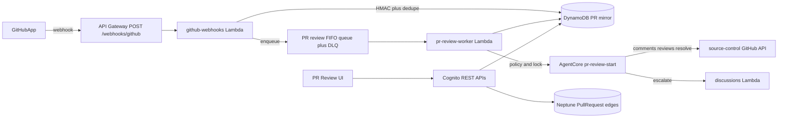

# PR/Review design

**Date:** 2026-10-16
**Status:** Draft for review
**Phase 1 goal:** GitHub sends a webhook, Collaborative AI-DLC tracks AIDLC delivery pull requests, and a review agent comments, replies, resolves its own threads, submits a formal verdict, and escalates product questions into an intent Discussion.

## Decisions

| Topic | Choice |
| --- | --- |
| Scope | Phased. Phase 1 is AIDLC delivery and unit PRs only. A later phase tracks any open PR in a bound repo. |
| Autonomy | Fully automatic when project policy is `on`. A project can pause or turn it off. |
| Actions | Phase 1 is review-only. A later phase may push targeted fix commits. |
| Provider | GitHub only in phase 1, via the existing GitHub App. |
| Verdicts | `COMMENT`, `REQUEST_CHANGES`, or `APPROVE`, gated by project approve policy. |
| Escalation | Code questions stay on the GitHub thread. Requirements or product ambiguity opens one intent Discussion and a short GitHub comment with the app link. |
| Ingress | `POST /webhooks/github` verifies HMAC, writes a PR mirror, and enqueues SQS. A worker runs AgentCore. |

## Architecture

The durable v2 orchestrator stays the owner of intent construction and of opening delivery PRs. This feature does not start an intent and does not push commits in phase 1.

### Ingress

Add an unauthenticated API Gateway route, `POST /webhooks/github`, using the same `authorization = NONE` pattern as the existing OAuth callbacks. The Lambda reads the raw body, checks `X-Hub-Signature-256` with the webhook secret in Secrets Manager, and rejects a bad signature with `401`.

Accepted events:

- `pull_request` (`opened`, `synchronize`, `reopened`, `closed`, `ready_for_review`)
- `pull_request_review`
- `pull_request_review_comment`
- `issue_comment` only when `issue.pull_request` is present

Any other event, or a body that is not JSON, returns `200` and is dropped so GitHub does not retry it forever.

`X-GitHub-Delivery` is stored for 24 hours. A duplicate delivery returns `200` and is not enqueued again.

### Routing

Resolve `repository.full_name` through the existing source-control bindings. Continue only when all of these are true:

1. The binding is an active GitHub App binding for a project.
2. Project `autoReview` is `on`.
3. The pull request number matches an AIDLC intent delivery PR or unit PR for that repository (Dynamo process records and Neptune `Intent --HAS_PR--> PullRequest` / unit PR edges).

Otherwise return `200`, do not create a mirror row, and do not enqueue. Phase 2 removes condition 3.

Ignore the event when the sender is the GitHub App, or when a comment body contains the marker `<!-- aidlc-pr-review -->`. A new head SHA or a human comment is what starts the next run.

### Queue

Use a FIFO queue plus a dead-letter queue.

- `MessageGroupId`: `{projectId}#{owner/repo}#{number}`
- `MessageDeduplicationId`: `X-GitHub-Delivery`
- Per-message delay: 20 seconds

The worker loads the mirror. If a newer triggering event was recorded after this message, it acknowledges and exits. That collapses `synchronize` and comment bursts into one review of the latest head. Transient GitHub `429` / `5xx` and AgentCore start failures retry with backoff. After the retry budget the message goes to the DLQ and the mirror status becomes `failed` with the last error.

A permanent skip (unknown repo, `autoReview` not `on`, daily cap, PR closed before start) is recorded as `skipped` with a reason and is not retried.

### Review job

Add AgentCore command `pr-review-start`, using the accept-then-background shape of `discussion-assist-start`. It loads the pull request diff, linked intent artifacts when present, and open human threads. It posts inline comments and one summary review, then updates the mirror and fans out on the existing intent or project WebSocket channel.

Two workers cannot review the same pull request at once. The worker takes a conditional lock on the mirror row (`status = reviewing`) with a 15-minute lease. If the lock is held, the message returns to the queue. When the lease expires, a later worker may take the lock.

### Credentials

Reuse GitHub App installation tokens from `lambda/shared/git-token.js`. Phase 1 mints a repo-scoped token with pull request write, issue write, and contents read. OAuth-only projects do not run auto-review. Project settings show auto-review as unavailable until an owner or admin binds the GitHub App.

The webhook secret is a new Secrets Manager value, separate from the App private key. Admin setup gains a webhook URL and secret alongside the existing App ID and private key. The setup doc line that says no webhook is needed is replaced for this feature.

## Data model

### PR mirror

DynamoDB, one item per `projectId#github#owner/repo#number`.

| Field | Purpose |
| --- | --- |
| `headSha` | SHA last seen from GitHub |
| `prState` | `open`, `closed`, or `merged` |
| `reviewStatus` | `idle`, `queued`, `reviewing`, `waiting_human`, `paused`, `skipped`, `failed` |
| `lastVerdict` | `COMMENT`, `REQUEST_CHANGES`, `APPROVE`, or empty |
| `reviewedSha` | SHA the last verdict applied to |
| `ownedThreadIds` | Review threads created by this agent |
| `intentId` | Set when the PR is an AIDLC delivery or unit PR |
| `dailyCount` / `dailyCountDate` | Cap enforcement |
| `lockExpiresAt` | Review lock lease |
| `lastError` | Shown in the UI when `failed` |
| `lastEventAt` | Debounce comparison |

Neptune `PullRequest` vertices stay the intent-graph link. The mirror is operational state, not a second graph.

### Project policy

Stored on the project:

| Field | Values | Default |
| --- | --- | --- |
| `autoReview` | `on`, `paused`, `off` | `on` for a new project that binds the GitHub App. Existing projects stay `off` until an owner or admin turns it on. |
| `approvePolicy` | `never`, `clean_only`, `allowed` | `clean_only` |
| `maxReviewsPerPrPerDay` | integer | `8` |

`paused` and `off` stop new jobs. An in-flight run may finish the GitHub post it already started, then it stops. It does not start a follow-up run.

## GitHub actions (phase 1)

Extend `lambda/shared/git-providers/github.js`:

- Reply in an existing review thread
- Resolve and unresolve a review thread (GraphQL)
- Submit one pull request review: `COMMENT`, `REQUEST_CHANGES`, or `APPROVE`

Every bot body ends with `<!-- aidlc-pr-review -->`.

The agent resolves a thread only when that thread id is in `ownedThreadIds` and either the latest human reply on that thread accepts the finding or a later head SHA removes the cited line. It does not resolve threads it did not create.

Phase 1 never pushes commits. The existing **Address feedback** path on unit lanes stays as the human-selected code-change path.

### Approve guard

| Policy | Behavior |
| --- | --- |
| `never` | Never submit `APPROVE`. Use `COMMENT` or `REQUEST_CHANGES`. |
| `clean_only` | Submit `APPROVE` only when the model returns zero blocking findings and `headSha` still equals the SHA that was reviewed. Otherwise `COMMENT` or `REQUEST_CHANGES`. |
| `allowed` | May submit `APPROVE` on a clean review of that same SHA. |

If `headSha` changes while the run is in progress, the worker posts nothing for the stale SHA. The newer queue message reviews the new head. A stale run never downgrades into a `COMMENT` or `APPROVE` on the old SHA.

Blocking findings produce `REQUEST_CHANGES`. Non-blocking notes produce `COMMENT`.

## Review loop

1. Webhook updates the mirror and enqueues a delayed message.
2. Worker checks policy, phase-1 match, cap, and debounce, then takes the lock.
3. `pr-review-start` reads the diff and intent context.
4. It posts inline comments and one summary review under the approve guard.
5. A later human reply on a bot thread is answered in that GitHub thread.
6. Owned threads that are clearly addressed are resolved.
7. Requirements or product ambiguity opens or reuses one Discussion on the linked intent, posts a short GitHub comment with the app link, and sets `reviewStatus` to `waiting_human`.
8. `waiting_human` clears when a project member posts in that Discussion or a human comments on the pull request. The next qualifying webhook resumes the loop.

Daily cap: at most 8 review runs per pull request per UTC day. A run is one `pr-review-start` invocation. Over-cap events set `skipped` with reason `daily_cap` until the next UTC day.

## UI

- Route: `/space/:projectId/reviews`
- Lists open AIDLC pull requests for the project: repository, number, review status, last verdict, link to GitHub, link to the intent
- `failed` rows show `lastError` and a **Retry review** action for project members
- Project settings gain `autoReview`, `approvePolicy`, and the daily cap
- Intent unit cards keep **Address feedback**

## Errors and security

| Case | Result |
| --- | --- |
| Bad HMAC | `401` |
| Duplicate `X-GitHub-Delivery` | `200`, no enqueue |
| Unsupported event | `200`, drop |
| Signature valid, enqueue fails | `500` so GitHub retries |
| Bot or marker event | `200`, drop |
| Not an AIDLC PR (phase 1) | `200`, drop |
| `autoReview` paused or off | mirror `skipped` when a row already exists; otherwise drop |
| Daily cap | `skipped` / `daily_cap` |
| GitHub `429` or `5xx`, AgentCore start failure | queue retry, then DLQ and `failed` |
| Head SHA changed during the run | do not submit `APPROVE`; post nothing for the stale SHA and let the newer message review |

The webhook Lambda has no Cognito authorizer. It cannot read project data beyond the binding lookup required to route, and it cannot mint tokens until the signature check passes.

## Tests

Unit:

- HMAC accept and reject
- Delivery-id dedupe
- Phase-1 filter: AIDLC PR continues, unknown PR is dropped
- Debounce: a newer mirror event supersedes an older queue message
- Bot login and marker footer do not enqueue
- Approve-policy matrix, including SHA mismatch
- Resolve only for `ownedThreadIds`

Worker, with fake GitHub and fake AgentCore:

- One opened delivery PR posts one review
- A human reply posts one thread reply
- An App-authored comment does not enqueue

UI:

- Reviews list renders status, verdict, and links
- Project settings persist `autoReview` and `approvePolicy`

## Phase 1 done when

A configured GitHub App webhook for an AIDLC delivery pull request creates a mirror row, runs one automatic review, posts comments plus a formal verdict under approve policy, replies and resolves only its own threads, escalates product questions into one intent Discussion, and can be paused per project. No commits are pushed.

## Later phases

These are out of phase 1 and are sequenced, not optional design forks:

1. **Targeted fixes.** Same queue and mirror. A new command may push commits that address the agent's own open findings. Still no review of arbitrary PRs.
2. **Project-wide inbox.** Drop the AIDLC-PR filter. Any open pull request in a GitHub App-bound repo is mirrored and reviewed under the same policy.
3. **Other providers.** GitLab, then Bitbucket, using the same mirror and queue shape.

## Files this design expects to touch

- `lambda/github-webhooks/` (new) and `terraform/modules/api/routes.tf`
- `lambda/pr-review-worker/` (new)
- `lambda/agentcore/commands/pr-review-start.js` (new) plus command registry
- `lambda/shared/git-providers/github.js` for reply, resolve, and submit-review
- DynamoDB table and Secrets Manager webhook secret in Terraform
- `frontend/src/App.tsx` route `/space/:projectId/reviews` and project settings
- `docs/getting-started/setup.md` and `docs/using-the-platform/git-integration.md`
